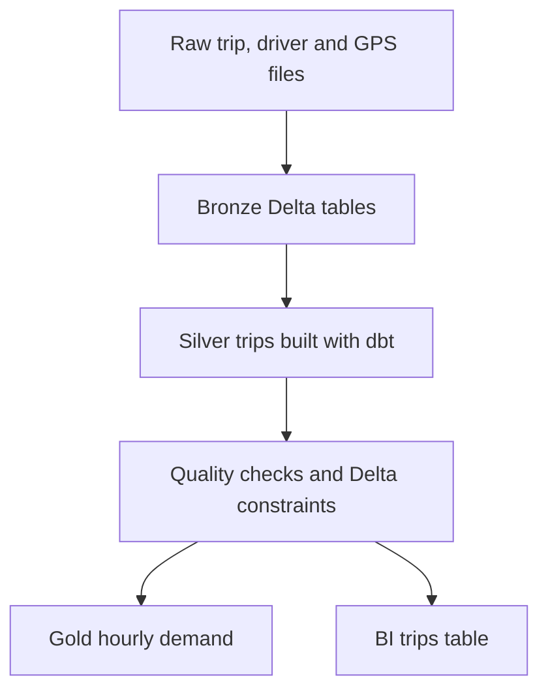

# Masar Mini-Lakehouse

A small lakehouse built as the project of the course **SDA-DSC-214: Modern Data Engineering for AI Systems** at SDAIA Academy.

- Author: Rahaf Alharbi
- Date: 2026-11-26
- Official SDAIA Academy GitHub: [github.com/SDAIAAcademy](https://github.com/SDAIAAcademy)
- Course starting repository: [altherwy/masar-lakehouse](https://github.com/altherwy/masar-lakehouse)

## What this project is

Masar is a fictional ride-hailing company in Saudi Arabia. The project uses synthetic trip, driver, and GPS data for five cities. It turns raw files into Delta tables for analytics using three layers: Bronze, Silver, and Gold. The capstone produces a table for BI reporting. The course also includes separate streaming and machine-learning exercises.

## Architecture



Bronze keeps the source records as they arrived. Silver cleans and validates the trips. Gold summarizes demand by city, date, and hour. The BI table uses pseudonymized rider and driver IDs and less precise drop-off locations.

## What I built

| Day | Topic | Course work and capstone implementation |
| --- | --- | --- |
| 1 | Bronze, file formats, and cost | Loaded and profiled raw data. The course also covers file-format and scan-cost comparisons. |
| 2 | Silver with dbt and Delta | Built Silver with dbt, verified its tests, rejected invalid writes, and added `promo_code` to a demo table. |
| 3 | Delta changes and streaming | The course covers MERGE, Time Travel, Delta maintenance, and Kafka streaming. The capstone proof reads historical Delta versions. |
| 4 | Data quality and orchestration | Passed the Silver data contract and connected Bronze, dbt, quality checks, Gold, and BI through `make pipeline`. |
| 5 | Serving and capstone | Built and checked `bi_trips_safe`, compared Delta versions, and recorded the results in `capstone/SUBMIT.md`. |

## Technology

- Python 3.11 and Java 17
- Apache Spark 3.5.1 and Delta Lake 3.2.0
- dbt 1.8 with the Spark adapter
- Apache Kafka 3.7.0 for the separate streaming exercise
- Great Expectations 0.18.19
- GitHub Codespaces

## Project structure

| Path | Purpose |
| --- | --- |
| `src/masar/ingest/` | Load and profile Bronze data |
| `src/masar/econ/` | File formats, scan cost, and cost modeling |
| `src/masar/delta/` | Constraints, MERGE, Time Travel, and file maintenance |
| `src/masar/stream/` | Kafka producer and streaming ingestion |
| `src/masar/quality/` | Data contract, quality gate, observability, and retention |
| `src/masar/transform/` | Gold tables |
| `src/masar/serve/` | BI table and training set exercises |
| `src/masar/pipeline.py` | Run the capstone pipeline |
| `dbt/masar/` | dbt staging models, Silver models, and tests |
| `capstone/` | Capstone brief, submission, and expected counts |
| `Makefile` | Commands such as `make data` and `make pipeline` |

## How to run it

Open the repository in GitHub Codespaces. Run these commands from the repository root and wait for each one to finish.

```bash
export PYTHONPATH="$PWD/src"
make doctor
make data
make dbt-deps
make pipeline
```

`make pipeline` loads and registers Bronze, builds and tests Silver with dbt, checks data quality, adds any missing Delta constraints, builds the Gold and BI tables, and prints row counts.

I skip Bronze ingestion when all three Bronze Delta tables already exist. The landing script appends rows, so skipping this step avoids loading the same records twice. The pipeline stops if only some Bronze tables exist or if a required stage fails.

For the separate streaming exercise, use `make kafka-up` to start Kafka and `make kafka-down` when finished.

For a clean-state run, `make clean-lakehouse` removes the generated tables and their local history, the Spark metastore, and dbt build artifacts. It keeps `data/`. Run `make pipeline` after the cleanup.

## Capstone

The [capstone brief](capstone/CAPSTONE.md) defines the tasks. See the [expected counts](capstone/checks/expected_counts.md) for the checkpoints and the [submission](capstone/SUBMIT.md) for the observed results.

1. Load and register Bronze.
2. Build Silver with dbt and pass the quality gate.
3. Test a Delta constraint and demonstrate a schema change.
4. Build a Gold mart.
5. Build a consumer table. I chose the BI table.
6. Run the full workflow with `make pipeline` from a clean state.
7. Report row counts and demonstrate Delta Time Travel.
8. Complete `capstone/SUBMIT.md` and submit the GitHub branch.

## Results

| Output | Rows |
| --- | ---: |
| Bronze trips | 48,200 |
| Bronze drivers | 1,850 |
| Bronze GPS pings | 120,000 |
| Silver trips | 44,371 |
| Gold hourly demand | 120 |
| BI-safe trips | 44,371 |

- **Quality.** All seven Silver data-contract checks passed. The dbt build and tests completed successfully.
- **Delta controls.** Delta rejected a negative fare and a fare submitted as text. I added `promo_code` to a demo table and verified that the old rows were retained.
- **Pipeline.** `make pipeline` completed in Codespaces with Bronze already loaded. A clean-state run remains to be verified.
- **BI.** The BI table was checked for the raw fields `rider_id`, `driver_id`, and `dropoff_geohash`. None were present.
- **Time Travel.** The main Silver table had 44,371 rows in both versions 0 and 5. In a separate demo copy, the count changed from 44,371 in version 0 to 44,370 in version 1 after deleting one trip.

## Limits of this project

This teaching lakehouse runs on one machine with synthetic data. The capstone uses file-based ingestion and a manually triggered pipeline. Kafka streaming runs as a separate course exercise.

## Acknowledgements

Built during SDA-DSC-214 at [SDAIA Academy](https://github.com/SDAIAAcademy), starting from the course repository linked above.